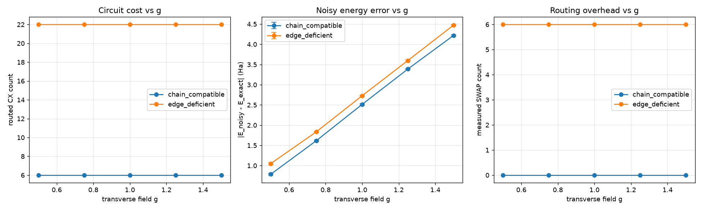

# Noise-Aware Algorithm↔Architecture Co-Design of a Variational Quantum Simulator for the Transverse-Field Ising Model

**PS-S1 · Quantum Simulation Track · Phase 1 submission**

We study how **processor connectivity** changes the hardware cost of running the *same*
variational algorithm. Using VQE on a 4-site Transverse-Field Ising Model (TFIM), we
benchmark on two fixed architectures (**Processor A**, **Processor B**) and a **simulated
proposed Processor C**, measuring transpiled circuit cost and noisy shot-based energy
accuracy under identical conditions.

> **Scope of the claim (intentionally narrow).** For **this 4-site VQE workload**,
> processor connectivity changes transpiled circuit cost, and the added gate overhead
> **can** increase noise sensitivity. We do **not** claim a universal "routing is the
> bottleneck" result beyond this instance.

---

## Headline results (g = 1.0)

**Circuit cost** (identical 2-layer ansatz, `seed_transpiler=42`, measured not inferred):

| Processor | logical 2Q | routed CX | depth | measured SWAP |
|---|---|---|---|---|
| A (5q, chorded) | 6 | **9** | **33** | **1** |
| B (9q, heavy-hex) | 6 | 6 | 13 | 0 |
| **C (simulated, 6q path)** | 6 | 6 | 13 | 0 |

All three start from the **same 6 logical two-qubit gates**. Routing onto A's chorded map
raises CX to 9 (depth 33, 1 measured SWAP); B and C need no SWAPs.

**Noisy, shot-based VQE energy** on each processor's **routed** circuit (same noise model —
0.5% depolarizing on CX, 0.1% on 1Q — same 8192-shot budget, 3 seeds; `E_exact = -4.7588` Ha):

| Processor | routed CX / depth | E_noisy (mean) | σ | \|E − E_exact\| |
|---|---|---|---|---|
| A | 9 / 33 | −4.3802 | 0.0231 | **0.379** |
| B | 6 / 13 | −4.5396 | 0.0170 | **0.219** |
| C | 6 / 13 | −4.5396 | 0.0170 | **0.219** |

Processor A's extra routing gates measurably degrade the noisy energy estimate (error
**0.379** vs **0.219** Ha) — this is measured evidence, not an assumption, that a higher
routed gate count can cost accuracy.

**Ideal (noiseless) VQE** is identical across processors *by construction* — energy and
fidelity depend only on the optimized parameters, not the chip. VQE converges to error
10⁻³–10⁻⁴ Ha with fidelity 0.998–1.000 against exact diagonalization.

---

## Why this matters
Variational algorithms (VQE/QAOA) are leading near-term candidates for quantum advantage,
but their success is decided by the hardware. A nearest-neighbour interaction like
`Z_i Z_{i+1}` needs a CNOT between *connected* qubits. When the chip lacks that edge, the
compiler inserts **SWAP gates** (each = 3 CNOTs), deepening the circuit and adding noise.

## The architecture finding
Processor A's coupling map is `(0,1),(1,2),(1,3),(3,4)`. The edge `(1,3)` is a **chord that
skips qubit 2** — routing the chain `0-1-2-3` forces an extra SWAP and ~2.5× depth.
Processor B contains a clean cycle `0-1-2-3-4-5-6`, so the identical chain maps with **zero
SWAPs**. We verify this by transpiling onto each real coupling map with a **fixed
`seed_transpiler`** and reporting logical count, routed CX, depth, and measured SWAP ops
separately.

## Honest methodology
- **Reproducible:** `seed_transpiler=42` fixed; identical compilation settings for A/B/C.
- **Measured, not inferred:** logical 2Q, routed CX, depth, and SWAP are each reported
  independently — SWAP count is read from the routed circuit, never back-computed.
- **Fair noise comparison:** same noise model and shot budget for all three; 3 seeds give
  reported variability (σ).
- **Correctness checked:** exact ground state (`-4.7588` Ha) verified against an independent
  term-by-term Hamiltonian construction.

## Repository layout
```
├── main.ipynb              # runnable solution notebook (deliverable)
├── main_executed.ipynb     # executed copy (proof it runs end-to-end)
├── index.html              # demo website (GitHub Pages)
├── requirements.txt        # pinned environment
├── processors/             # coupling maps (source of truth)
│   ├── A.json              # 5-qubit Phase-1 benchmark
│   ├── B.json              # 9-qubit heavy-hex Phase-1 benchmark
│   └── C.json              # simulated proposed processor
├── src/
│   ├── engine.py           # TFIM Hamiltonian, exact diagonalisation, VQE ansatz
│   └── experiment.py       # benchmark: optimise, transpile, noisy energy, plots
└── results/                # all figures + tables (generated)
```

## Reproduce (3 steps)
```bash
pip install -r requirements.txt
cd src
python experiment.py        # ~20 s; regenerates everything in ../results
```
Or execute the notebook: `jupyter nbconvert --to notebook --execute main.ipynb`

## Coupling-topology ablation study

To test whether the co-design result holds beyond a single topology, we ran an ablation
comparing two topologies under **identical settings**: same Hamiltonian, same VQE ansatz,
same optimized parameters `θ`, same noise model (0.5% depol. on CX, 0.1% on 1Q), same
8192-shot budget, and same 3 seeds. The only variable changed was the coupling graph.

**Topologies tested:**
- **Chain-compatible** (baseline): `(0,1),(1,2),(2,3),(3,4),(4,5)` — supports all required NN interactions natively.
- **Edge-deficient**: `(0,1),(2,3),(3,4),(4,5),(0,5)` — removes edge `(1,2)`, adds bridge `(0,5)` to keep the graph connected while forcing longer routing paths.

**Measured results** (transpiled onto each topology with `seed_transpiler=42`; noisy
energy from measurement counts, 3 seeds, mean ± σ):

| g | Topology | routed CX | depth | SWAPs | E_noisy mean | σ | \|E_noisy − E_exact\| |
|---|---|---|---|---|---|---|---|
| 0.5 | chain_compatible | 6 | 13 | 0 | −2.6412 | 0.0221 | 0.7859 |
| 0.5 | edge_deficient | 22 | 49 | 6 | −2.3766 | 0.0252 | 1.0504 |
| 0.75 | chain_compatible | 6 | 13 | 0 | −2.3872 | 0.0110 | 1.6187 |
| 0.75 | edge_deficient | 22 | 49 | 6 | −2.1678 | 0.0125 | 1.8381 |
| 1.0 | chain_compatible | 6 | 13 | 0 | −2.2443 | 0.0156 | 2.5145 |
| 1.0 | edge_deficient | 22 | 48 | 6 | −2.0294 | 0.0113 | 2.7293 |
| 1.25 | chain_compatible | 6 | 13 | 0 | −2.2177 | 0.0099 | 3.3883 |
| 1.25 | edge_deficient | 22 | 48 | 6 | −2.0065 | 0.0188 | 3.5995 |
| 1.5 | chain_compatible | 6 | 13 | 0 | −2.2843 | 0.0189 | 4.2196 |
| 1.5 | edge_deficient | 22 | 49 | 6 | −2.0294 | 0.0156 | 4.4745 |

**Summary of the ablation:**
- **Routing cost:** The edge-deficient topology required **22 CX / depth 48–49 / 6 SWAPs**, versus **6 CX / depth 13 / 0 SWAPs** for the chain-compatible topology — a **+16 CX (≈3.7×), +35–36 depth, +6 SWAP** overhead in this tested configuration.
- **Noisy accuracy:** In every tested value of `g`, the edge-deficient topology's noisy VQE energy error was **higher** than the chain-compatible topology's, by **0.22–0.26 Ha**.

**Honest scope:** This is a measured comparison for **this specific 4-site VQE workload
and these two topologies**. The extra routing gates and the higher noisy error co-occur;
we report the association rather than claiming universal causation. Three seeds provide
preliminary variability estimates. See `src/ablation.py` and `results/ablation_results.csv`
for the full reproducible experiment.



## Processor C — simulated proposed topology
Processor C is a **simulated, proposed** 6-qubit open path
`(0,1),(1,2),(2,3),(3,4),(4,5)`: **4 qubits run the VQE, 2 are reserved (currently
unused)**. It matches B's cost (6 CX / depth 13 / 0 SWAP) with fewer qubits. The reserved
qubits are a design placeholder for future ancilla-based mitigation — **no mitigation
benefit is claimed or measured** in this submission.

## PS-S1 requirement mapping

Every official requirement from the challenge PDF is mapped to a specific implementation,
experiment, figure, or command. Source: `Problem_Statment_Details.pdf`, PS-S1 (Quantum
Simulation Track).

| PDF Requirement | Where satisfied |
|---|---|
| **Problem:** Find ground-state energy and magnetization of 1D TFIM, 4 spins, H = −J Σ σᶻσᶻ − g Σ σˣ | `engine.py::tfim_hamiltonian` builds exactly this Hamiltonian (open chain, N=4). Energy from VQE; magnetization from `MAG_OBS` expectation. |
| **Baseline task:** VQE with suitable ansatz, estimate energy at J=1, g=1; compute ⟨Σσᶻ⟩ | `engine.py::ansatz` (hardware-efficient Ry+CX, 2 layers). `experiment.py::main()` runs at g=1.0. Magnetization reported per processor in `vqe_results.csv`. |
| **Deliverables:** Notebook with TFIM Hamiltonian, exact diagonalization comparison | `main.ipynb` cell 3 shows Hamiltonian and exact ground state. `engine.py::exact_ground` via `numpy.linalg.eigh`. |
| **Deliverables:** Run on Processor A/B, report energy, magnetization, fidelity | `experiment.py::main()` loops g ∈ {0.5, 1.0, 1.5} × processors {A, B, C}. All metrics in `results/vqe_results.csv` and `RESULTS.md`. |
| **Deliverables:** Plot magnetization vs g (optional) | `energy_error.png` shows VQE energy error vs g (closely related). Magnetization data in CSV. |
| **Metrics:** Accuracy — energy error, magnetization error vs exact | `abs_err` column in `vqe_results.csv`. Exact ground state from `exact_ground()`. |
| **Metrics:** Architecture — circuit CX count and depth per device | `cx`, `depth` columns in `vqe_results.csv` (routed, `seed_transpiler=42`). |
| **Metrics:** Number of variational parameters | 8 (REPS=2 × N=4) in `engine.py::ansatz`. Documented in `README.md`. |
| **Data/Instances:** TFIM with J=1.0, g ∈ {0.5, 1.0, 1.5} | `experiment.py` line: `for g in (0.5, 1.0, 1.5)`. Exactly these values. |
| **Processor A:** 5-qubit, edges (0,1),(1,2),(1,3),(3,4) | `processors/A.json`. Loaded by `experiment.py::processors()`. |
| **Processor B:** 9-qubit, heavy-hex, edges (0,1),(1,2),(1,6),(2,3),(2,6),(2,5),(3,4),(4,5),(5,6),(6,7),(6,8),(8,0) | `processors/B.json`. Loaded by `experiment.py::processors()`. |
| **Calibration:** 2-qubit error ~0.5%, 1-qubit ~0.1% | `processors/A.json` and `B.json`: `two_qubit_gate_error: 0.005`, `one_qubit_gate_error: 0.001`. Loaded and applied in `experiment.py::main()`. |
| **Submission:** README, environment spec, notebook, data/processor files, results/figures, report | `README.md`, `requirements.txt`, `main.ipynb`, `processors/*.json`, `results/` (4 figures + CSV + JSON + RESULTS.md). |
| **Reproducibility:** Code must run end-to-end on provided Qiskit backends | Validated: `jupyter nbconvert --to notebook --execute main.ipynb` runs cleanly (see `main_executed.ipynb`). `python src/experiment.py` regenerates all results in ~20 s. |

**Beyond the baseline (additional contributions):**
- Noisy, shot-based VQE energy estimation on each routed processor (`experiment.py::noisy_energy`)
- Coupling-topology ablation study (chain-compatible vs edge-deficient) across g sweep (`ablation.py`)
- Proposed Processor C design with quantified justification (`processors/C.json`)
- Fixed `seed_transpiler=42` for reproducible architecture comparison
- Full reproducibility: pinned `requirements.txt`, single command regenerates everything

## What we'd do next (Phase 2 readiness)
- Scale to 6–8 spins to widen the A/B routing gap.
- Implement the reserved ancilla on Processor C and *measure* a mitigation benefit.
- Add zero-noise extrapolation and compare fidelity recovery A vs B vs C.
- Test whether A's hub topology ever wins for non-chain (e.g. all-to-all) Hamiltonians.

---
*Built for the Algorithm↔Architecture Co-Design Challenge. All numbers are reproducible from `src/experiment.py`.*
